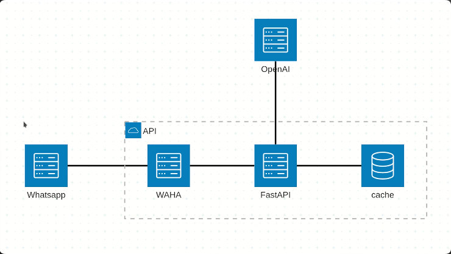
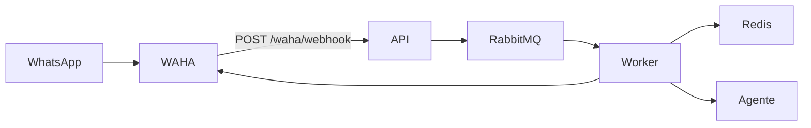

# Agente de WhatsApp com Agno

Agente de atendimento no WhatsApp para qualquer empresa. A mensagem chega pelo WAHA, a API enfileira o pedido e um worker responde com cache semântico ou com o agente de IA.

A fonte de informação é o markdown em [data/empresa.md](data/empresa.md). As regras do assistente estão em [data/prompt.xml](data/prompt.xml). Troque esses dois arquivos pelo conteúdo e pelos assuntos da empresa: o agente responde só com base neles.

## Arquitetura



WhatsApp → API → fila → agente de IA + cache no Redis.



1. A pessoa envia a mensagem no WhatsApp.
2. O WAHA chama o webhook `POST /waha/webhook`.
3. A API (FastAPI) publica a tarefa no RabbitMQ e responde na hora, sem esperar a IA.
4. O worker (Celery) consulta o cache semântico no Redis.
5. Se já existe uma resposta parecida, reaproveita. Se não, o agente (Agno + GPT-4o-mini) responde com base no conteúdo do negócio.
6. A resposta volta ao WhatsApp pela API do WAHA.

## Stack

- **WAHA** (porta 3000): sessão do WhatsApp e webhook.
- **FastAPI** (porta 8000): recebe o webhook.
- **RabbitMQ** (porta 5672, painel em 15672): fila das mensagens.
- **Celery**: worker que gera a resposta.
- **Redis Stack** (porta 6379): cache semântico.
- **Agno + GPT-4o-mini**: agente.

O cache, em [workers/tasks.py](workers/tasks.py), guarda a resposta por 360 segundos e só reaproveita quando a pergunta é muito parecida (`distance_threshold` 0.1).

## Como rodar

Requisitos: Docker e a extensão Dev Containers.

1. Copie o exemplo de ambiente e coloque a chave da OpenAI:

```bash
cp env_exemplo .env
```

2. Abra o projeto no Dev Container (`Whatsapp-Agno-DEV`). Ele sobe o [compose.yml](compose.yml) com WAHA, RabbitMQ, Redis e a API.
3. No container, instale as dependências:

```bash
uv sync
```

4. Em um terminal, suba a API:

```bash
sh scripts/start_server.sh
```

5. Em outro terminal, suba o worker:

```bash
sh scripts/start_worker.sh
```

6. Abra o painel do WAHA em `http://localhost:3000` e entre com `WAHA_DASHBOARD_USERNAME` e `WAHA_DASHBOARD_PASSWORD`. Inicie a sessão `default` e leia o QR Code com o WhatsApp. O nome da sessão precisa ser o mesmo de `WAHA_SESSION_NAME`.

O webhook já aponta para `http://api:8000/waha/webhook` e escuta os eventos `message` e `session.status`.

## Variáveis de ambiente

- `OPENAI_API_KEY`, no `.env`: chamada do modelo no worker.
- `WAHA_API_KEY`, no `.env`: chave enviada no header `X-Api-Key` e exigida pelo WAHA a partir da versão 2025.10.3.
- `WAHA_DASHBOARD_USERNAME` e `WAHA_DASHBOARD_PASSWORD`, no `.env`: login do painel em `http://localhost:3000`.
- `WHATSAPP_SWAGGER_USERNAME` e `WHATSAPP_SWAGGER_PASSWORD`, no `.env`: login do Swagger do WAHA.
- `WHATSAPP_DEFAULT_ENGINE`, no `.env`: motor da sessão (`WEBJS`).
- `WAHA_API_URL`, no [compose.yml](compose.yml): envio da resposta (`/sendText`).
- `WAHA_SESSION_NAME`, no [compose.yml](compose.yml): sessão do WAHA (`default`).

Preencha usuário e senha no `.env` local. O [env_exemplo](env_exemplo) deixa esses campos em branco.

O arquivo `.env` não entra no Git.

## Estrutura

```
app.py                    API FastAPI
routers/waha_router.py    Webhook e despacho dos eventos
services/waha_service.py  Envio da mensagem de volta ao WhatsApp
workers/tasks.py          Fila, cache semântico e agente
data/empresa.md           Conteúdo da empresa, usado como fonte
data/prompt.xml           Instruções do assistente
compose.yml               WAHA, RabbitMQ, Redis e API
scripts/                  Sobe a API e o worker
```

## Painéis locais

- API: `http://localhost:8000/docs`
- WAHA: `http://localhost:3000`
- RabbitMQ: `http://localhost:15672` (usuário e senha `guest`, só para desenvolvimento local)
